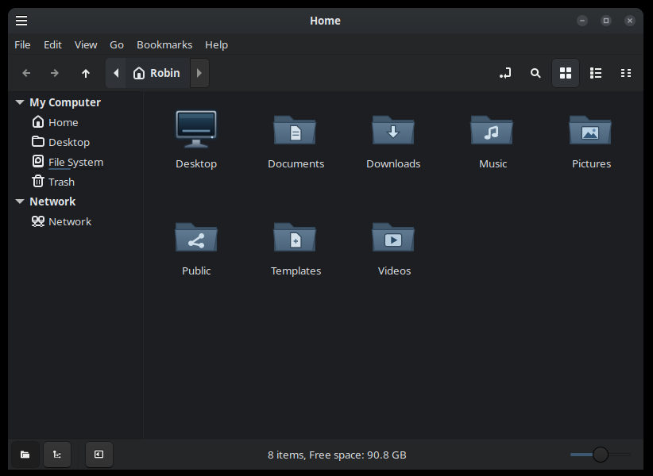

# Apartment Blue

A dark theme for Cinnamon, MATE and Xfce with graphite window buttons and blue folder icons.

[Cinnamon screenshots at 1× and 2×](apartment-blue/screenshots/README.md) · [Caja on MATE (0.6.0)](apartment-blue/mate-0.6.0.png) · [Thunar on Xfce (0.6.0)](apartment-blue/xfce-0.6.0.png) · [Celluloid on Cinnamon (0.6.0)](apartment-blue/celluloid-0.6.0.png)

## Install

From the `apartment-blue` directory, copy `themes/Apartment-Blue` into `~/.themes/` and `icons/Apartment-Blue` into `~/.icons/`.

Open your desktop’s appearance settings to select the theme. The [installation guide](apartment-blue/README.md) covers window borders, Xfce HiDPI and the optional libadwaita override.

[Changelog](apartment-blue/CHANGELOG.md) · [License and credits](apartment-blue/NOTICE.md)
