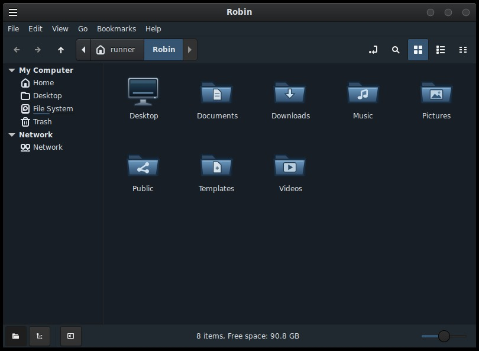

# Apartment Blue

A dark theme for Cinnamon, MATE and Xfce with graphite window buttons and blue folder icons.

[Cinnamon menu, calendar and notifications](apartment-blue/screenshots/cinnamon-shell.jpg) · [Caja on MATE](apartment-blue/screenshots/mate.jpg) · [Thunar on Xfce](apartment-blue/screenshots/xfce.jpg) · [Window button states at 1×](apartment-blue/screenshots/1x-muffin.png)

## Install

From the `apartment-blue` directory, copy `themes/Apartment-Blue` into `~/.themes/` and `icons/Apartment-Blue` into `~/.icons/`.

Open your desktop’s appearance settings to select the theme. The [installation guide](apartment-blue/README.md) covers window borders, Xfce HiDPI and the optional libadwaita override.

[Changelog](apartment-blue/CHANGELOG.md) · [License and credits](apartment-blue/NOTICE.md)
